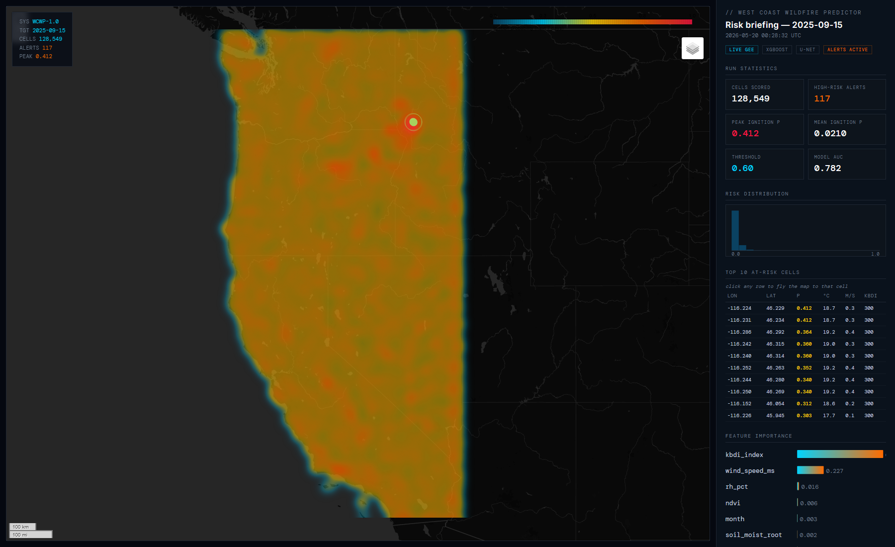

# West Coast Wildfire Prediction

[](https://github.com/raahimnawaz/wildfire/actions/workflows/tests.yml)
[](https://github.com/raahimnawaz/wildfire/actions/workflows/daily-dashboard.yml)
[](LICENSE)
[](https://raahimnawaz.github.io/wildfire/)

An operational two-stage wildfire prediction pipeline for the US West Coast.
Trained on **real** Google Earth Engine satellite data and the canonical
**Next Day Wildfire Spread** benchmark from Google Research.

> **▶ Click the screenshot below or the live-demo badge above to open the interactive dashboard** — pan, zoom, click cells for popups, click rows in the top-10 table to fly the map to that location.

| Model | Task | Real-data metrics | Benchmark |
|---|---|---|---|
| **XGBoost ignition** | Per-cell 7-day fire start probability | ROC-AUC **0.785** · AP 0.0055 (~5× the 0.0011 base rate) at 2 km, May-Oct coverage | Train 2020-2023 · threshold tuned on 2024 · tested once on 2025 · production refit on 2020-2026 incl. season-to-date |
| **U-Net spread** | Per-pixel next-day fire mask | ROC-AUC **0.903** · AUC-PR **0.295** | Matches Huot et al. ICDM 2022 |

## What this is

Two complementary models that together cover the wildfire-prediction lifecycle:

1. **Ignition** — "where might a fire START in the next week?" Boosted-tree
   classifier on ~24.5M live GEE-extracted West Coast cells covering
   May-October of 2020-2026 (fire season plus the shoulder season, so
   early-season predictions are in-distribution rather than calendar
   extrapolation). Evaluation is fully out-of-time: train 2020-2023, alert
   threshold tuned on held-out 2024, tested exactly once on 2025 — then the
   shipped production model is refit on everything, including the 2026
   season-to-date. Top feature importances (KBDI drought + wind speed) are
   consistent with the wildfire physics literature, with a caveat stated
   plainly: the domain-guided augmentation pushes synthetic positives into
   exactly those regimes, so the importances partly reflect the training
   design.
2. **Spread** — "given a fire is burning, what does tomorrow's perimeter look
   like?" U-Net segmentation on 64×64 km imagery patches with 11 channels
   (elevation, slope, aspect, NDVI, temp, dewpoint, wind u/v, KBDI, soil
   moisture, prior fire mask). AUC-PR matches the canonical NDWS benchmark.

A combined dashboard CLI runs both models on any date and produces a
satellite-style HUD heatmap plus structured outputs (parquet, GeoJSON, JSON).

[](https://raahimnawaz.github.io/wildfire/)

## Data sources

| Source | What | Where it lives in the pipeline |
|---|---|---|
| **ERA5-Land** (ECMWF) | Hourly weather: temp, dewpoint, wind u/v, soil moisture | Ignition + spread input |
| **SRTM** (USGS) | 30 m elevation → slope + aspect | Ignition + spread input |
| **NASA SMAP** | Surface soil moisture | Ignition + spread input |
| **UTOKYO KBDI** | Keetch-Byram Drought Index | Ignition + spread input |
| **MODIS NDVI** | 16-day vegetation index composites | Ignition + spread input |
| **NASA FIRMS** | MODIS T21 thermal anomalies | Ignition labels |
| **Next Day Wildfire Spread** (Huot et al. ICDM 2022) | 18,545 64×64 km patches of real CONUS fires (2012-2020) | Spread training |

## Repository layout

```
wildfire/
  config.py            central constants (bbox, paths, hyperparams, threshold)
  features.py          feature engineering (wind speed, RH, VPD, calendar)
  imbalance.py         domain-guided synthetic minority injection
  synthetic_data.py    offline smoke-test data generator (no GEE auth needed)
  data_extraction.py   GEE pipeline + extract_window + extract_patch (cached)
  cache.py             disk cache for GEE results (parquet + npy)
  train.py             XGBoost training with out-of-time validation + threshold tuning
  predict.py           XGBoost scoring CLI
  dashboard.py         combined ignition + spread CLI
  service.py           interactive per-point risk API (FastAPI)
  heatmap.py           satellite-style HUD heatmap (folium + custom shell)
  setup_gee.py         GEE connectivity verifier
  run_real.py          one-shot end-to-end runner
  spread/              Phase 2 — next-day fire spread
    config.py
    model.py           ConvLSTM cell + U-Net wrapper (smp)
    data.py            Synthetic + NDWS numpy + dependency-free TFRecord parser
    convert_ndws.py    TFRecord → numpy with official train/val/test split
    losses.py          weighted BCE + soft Dice
    train.py           PyTorch training
    predict.py         spread mask scoring
```

## Quick start

### Run with synthetic data (no auth required)

```powershell
pip install -r wildfire/requirements.txt
python -m wildfire.train --synthetic
```

### Run with real data (requires GEE + Kaggle)

See [wildfire/README.md](wildfire/README.md) for the full GEE + Kaggle
walkthrough. Once auth is set up:

```powershell
# One-shot: pulls real data, trains both models
python -m wildfire.run_real

# Or generate a live risk dashboard for any date
$env:GEE_PROJECT = "your-gcp-project-id"
python -m wildfire.dashboard --date 2025-09-15
```

The dashboard writes to `wildfire_output/<date>/`:
- `heatmap_<date>.html` — satellite-style HUD visualization
- `ignition_<date>.parquet` — every scored cell + probability
- `ignition_<date>.geojson` — for QGIS / web maps
- `summary_<date>.json` — top-level metrics + spread predictions

### Serve interactive per-point risk

The dashboard answers "where is the risk today?" for the whole region, once a
day. To ask "what about *here*?" for an arbitrary point and date:

```powershell
$env:GEE_PROJECT = "your-gcp-project-id"
python -m wildfire.service --port 8000
```

```
POST /predict   {"lat": 39.8, "lon": -121.6, "target_date": "2025-09-15"}
GET  /model     metrics, threshold and feature importances, from the artifact
GET  /health
```

It scores a 32x32 grid of 2 km cells -- the cell size the model was trained on,
because a 200 m KBDI cell is not a 2 km KBDI cell -- through the same
`_stack_for_window` extraction and `score_dataframe` scoring the dashboard uses,
so there is no second copy of the feature pipeline to drift out of step.

Three things it deliberately will not do, because an earlier prototype did all
three:

- **It returns the model's calibrated probabilities, unscaled.** Min-max
  normalising each response makes a uniformly safe patch render identically to a
  dangerous one, and pins any "max risk" readout at exactly 100%.
- **Every quality number is read from `wildfire_models/feature_meta.json`** --
  test ROC-AUC, average precision, the validation-tuned threshold and its
  provenance. There is no metric literal in the module, and a metric the
  artifact does not carry is omitted rather than defaulted to something
  plausible.
- **No data is a 503, not a fallback.** If ERA5-Land latency leaves every window
  in the preceding 8 days empty, or the trained artifact is missing, it says so
  and names the fix. It never substitutes synthetic features into a risk map.

There is no uncertainty or saliency field. A boosted tree has no dropout to
sample, so an uncertainty band here would have been invented; the real
gain-based feature importance (KBDI 0.66, wind speed 0.29) is served instead.

## Engineering decisions worth calling out

Three non-obvious things that took real iteration to get right:

1. **Sentinel-mask trick for sparse GEE collections.** SMAP, KBDI, NDVI, and
   FIRMS all have data gaps. Calling `.mean()` on an empty `ImageCollection`
   returns a 0-band image that crashes any downstream `.multiply()` or
   `.rename()`. The fix: prepend a fully-masked sentinel image with the
   right band name to every collection. Masked pixels don't affect the mean,
   so the band always exists. See `_safe_mean()` in
   [wildfire/data_extraction.py](wildfire/data_extraction.py).

2. **Paged GEE sampling for the 5000-element limit.** `getInfo()` on a
   `FeatureCollection` caps at 5000 features — `numPixels=50000` silently
   fails. Workaround: N independent `.sample()` calls with different seeds,
   each under the limit, then concatenated and deduplicated by (lon, lat).
   Effective 10× density at the same per-call cost. See `extract_window()`.

3. **Leak-free threshold tuning.** The hardcoded operational threshold =
   0.60 produced zero alerts on real data — the fire base rate is ~0.15%,
   so calibrated probabilities rarely cross 0.60 even when the ranking is
   good. The threshold is now tuned from the PR curve on a held-out
   VALIDATION year (2024), frozen into model metadata, and the test year
   (2025) sees it exactly once. (An earlier version tuned on the test set
   itself, which inflated the reported precision — fixed, and worth
   admitting.) `predict.py` and the dashboard read the tuned value from
   metadata at inference time. See `_tune_threshold()` in
   [wildfire/train.py](wildfire/train.py).

## Testing

```powershell
pip install -r wildfire/requirements.txt
pytest tests/ -q
```

30 smoke tests covering cache hit/miss, feature math (wind speed, RH, VPD,
dewpoint inversion, calendar), imbalance handling — including thermodynamic
consistency of augmented rows — out-of-time validation splitting, threshold
tuning, and synthetic-data schema. All run CPU-only with no external
dependencies (no GEE, no GPU).

## Verification & live runs

The newest real-data dashboard snapshot is auto-published to GitHub Pages
by GitHub Actions nightly. Without credentials, CI redeploys the newest
committed snapshot (never synthetic stand-in data); adding a `GEE_SA_JSON`
service-account secret flips the same workflow into live mode — it
generates today's dashboard from a fresh GEE pull in-runner each night,
with the committed snapshot as automatic fallback. See
[.github/workflows/daily-dashboard.yml](.github/workflows/daily-dashboard.yml).
A long-form engineering writeup is in [WRITEUP.md](WRITEUP.md).

## License

Code: MIT. The NDWS dataset (Huot et al.) is CC BY 4.0 and not redistributed
here — see download instructions in
[wildfire/spread/README.md](wildfire/spread/README.md).

## Citations

- Huot et al., *Next Day Wildfire Spread: A Machine Learning Dataset to Predict Wildfire Spreading from Remote-Sensing Data*, ICDM 2022.
- Shi et al., *Convolutional LSTM Network: A Machine Learning Approach for Precipitation Nowcasting*, NeurIPS 2015.
- Rothermel, *A Mathematical Model for Predicting Fire Spread in Wildland Fuels*, USDA Forest Service, 1972.
