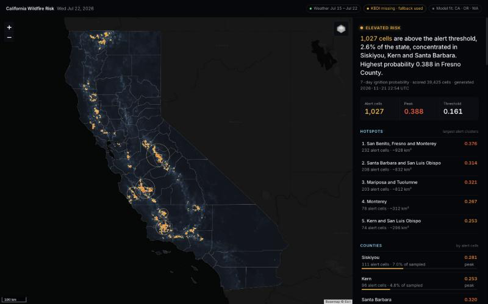

# California Wildfire Prediction

[](https://github.com/raahimnawaz/wildfire/actions/workflows/tests.yml)
[](https://github.com/raahimnawaz/wildfire/actions/workflows/daily-dashboard.yml)
[](LICENSE)
[](https://raahimnawaz.github.io/wildfire/)

An operational two-stage wildfire prediction pipeline for California.
Trained on **real** Google Earth Engine satellite data and the canonical
**Next Day Wildfire Spread** benchmark from Google Research.

> **Planned for** [wildfire-vtol](https://github.com/raahimnawaz/wildfire-vtol), whose drone fleet will feed live fire perimeters and fuel moisture into this model for 1–36 hour forecasts in the field.

> **▶ Click the screenshot below or the live-demo badge above to open the interactive dashboard** — hover any 2 km cell for its probability, click a cell, county or hotspot to see its inputs and what drove its score.

| Model | Task | Real-data metrics | Benchmark |
|---|---|---|---|
| **XGBoost ignition** | Per-cell 7-day fire start probability | ROC-AUC **0.785** · AP 0.0055 (~5× the 0.0011 base rate) at 2 km, May-Oct coverage | Train 2020-2023 · threshold tuned on 2024 · tested once on 2025 · production refit on 2020-2026 incl. season-to-date |
| **U-Net spread** | Per-pixel next-day fire mask | ROC-AUC **0.903** · AUC-PR **0.295** | Matches Huot et al. ICDM 2022 |

## What this is

Two complementary models that together cover the wildfire-prediction lifecycle:

1. **Ignition** — "where might a fire START in the next week?" Boosted-tree
   classifier on ~24.5M live GEE-extracted cells covering
   May-October of 2020-2026 (fire season plus the shoulder season, so
   early-season predictions are in-distribution rather than calendar
   extrapolation). Evaluation is fully out-of-time: train 2020-2023, alert
   threshold tuned on held-out 2024, tested exactly once on 2025 — then the
   shipped production model is refit on everything, including the 2026
   season-to-date. Top feature importances (KBDI drought + wind speed) are
   consistent with the wildfire physics literature, with a caveat stated
   plainly: the domain-guided augmentation pushes synthetic positives into
   exactly those regimes, so the importances partly reflect the training
   design.

   **Scope.** The pipeline now samples, scores and maps California only (the
   TIGER state polygon on Earth Engine, bundled county polygons locally;
   see [wildfire/region.py](wildfire/region.py)). The shipped model and the
   metrics in the table above predate that change: they come from
   California + Oregon + Washington training data. Retraining re-extracts
   through the California geometry (and `train.py` cuts any older
   West Coast parquet to California on load), which would give
   California-only metrics.
2. **Spread** — "given a fire is burning, what does tomorrow's perimeter look
   like?" U-Net segmentation on 64×64 km imagery patches with 11 channels
   (elevation, slope, aspect, NDVI, temp, dewpoint, wind u/v, KBDI, soil
   moisture, prior fire mask). AUC-PR matches the canonical NDWS benchmark.

A combined dashboard CLI runs both models on any date and produces a
California risk map plus structured outputs (parquet, GeoJSON, JSON). The map
is built like an operations view:

- **Answer first.** A header shows the day's risk level and input health
  (weather window, missing inputs, which data the model was fit on), and the
  panel opens with one sentence: how many cells are on alert and where.
- **Colour only for signal.** Below the alert threshold cells are quiet slate;
  at it the ramp jumps to amber, then to red by 3x. Alert cells shimmer (two
  summed sinusoids per cell, a fundamental and a golden-ratio overtone), and
  the five largest alert clusters get a slow breathing ring.
- **Everything can be traced.** Click a cell, county or hotspot and the panel
  becomes an inspector with the inputs and each input's contribution to the
  score (XGBoost per-feature contributions, which add up exactly to the
  cell's log-odds).
- **Risk level** is a display band on the share of cells over the threshold
  (Low < 0.1%, Moderate < 1%, Elevated < 5%, Severe ≥ 5%), not a model
  output, and the page says so.

[](https://raahimnawaz.github.io/wildfire/)

## Data sources

| Source | What | Where it lives in the pipeline |
|---|---|---|
| **ERA5-Land** (ECMWF) | Hourly weather: temp, dewpoint, wind u/v, soil moisture | Ignition + spread input |
| **SRTM** (USGS) | 30 m elevation → slope + aspect | Ignition + spread input |
| **NASA SMAP** | Surface soil moisture | Ignition + spread input |
| **UTOKYO KBDI** | Keetch-Byram Drought Index | Ignition + spread input |
| **MODIS NDVI** | 16-day vegetation index composites | Ignition + spread input |
| **NASA FIRMS** | MODIS T21 thermal anomalies | Ignition labels |
| **Next Day Wildfire Spread** (Huot et al. ICDM 2022) | 18,545 64×64 km patches of real CONUS fires (2012-2020) | Spread training |

## Repository layout

```
wildfire/
  config.py            central constants (region, paths, hyperparams, threshold)
  region.py            California boundary: GEE geometry, point-in-polygon, counties
  features.py          feature engineering (wind speed, RH, VPD, calendar)
  imbalance.py         domain-guided synthetic minority injection
  synthetic_data.py    offline smoke-test data generator (no GEE auth needed)
  data_extraction.py   GEE pipeline + extract_window + extract_patch (cached)
  cache.py             disk cache for GEE results (parquet + npy)
  train.py             XGBoost training with out-of-time validation + threshold tuning
  predict.py           XGBoost scoring CLI
  dashboard.py         combined ignition + spread CLI
  service.py           interactive per-point risk API (FastAPI)
  heatmap.py           California risk map (2 km grid on Leaflet, single HTML file)
  ca_counties.geojson  county outlines (codeforgermany/click_that_hood)
  setup_gee.py         GEE connectivity verifier
  run_real.py          one-shot end-to-end runner
  spread/              Phase 2 — next-day fire spread
    config.py
    model.py           ConvLSTM cell + U-Net wrapper (smp)
    data.py            Synthetic + NDWS numpy + dependency-free TFRecord parser
    convert_ndws.py    TFRecord → numpy with official train/val/test split
    losses.py          weighted BCE + soft Dice
    train.py           PyTorch training
    predict.py         spread mask scoring
```

## Quick start

### Run with synthetic data (no auth required)

```powershell
pip install -r wildfire/requirements.txt
python -m wildfire.train --synthetic
```

### Run with real data (requires GEE + Kaggle)

See [wildfire/README.md](wildfire/README.md) for the full GEE + Kaggle
walkthrough. Once auth is set up:

```powershell
# One-shot: pulls real data, trains both models
python -m wildfire.run_real

# Or generate a live risk dashboard for any date
$env:GEE_PROJECT = "your-gcp-project-id"
python -m wildfire.dashboard --date 2025-09-15
```

The dashboard writes to `wildfire_output/<date>/`:
- `heatmap_<date>.html` — the California risk map (one self-contained file, ~1.4 MB)
- `ignition_<date>.parquet` — every scored cell + probability
- `ignition_<date>.geojson` — for QGIS / web maps
- `summary_<date>.json` — top-level metrics + spread predictions

### Serve interactive per-point risk

The dashboard answers "where is the risk today?" for the whole state, once a
day. To ask "what about *here*?" for an arbitrary California point and date
(points outside the state get a 422):

```powershell
$env:GEE_PROJECT = "your-gcp-project-id"
python -m wildfire.service --port 8000
```

```
POST /predict   {"lat": 39.8, "lon": -121.6, "target_date": "2025-09-15"}
GET  /model     metrics, threshold and feature importances, from the artifact
GET  /health
```

It scores a 32x32 grid of 2 km cells -- the cell size the model was trained on,
because a 200 m KBDI cell is not a 2 km KBDI cell -- through the same
`_stack_for_window` extraction and `score_dataframe` scoring the dashboard uses,
so there is no second copy of the feature pipeline to drift out of step.

Three things it deliberately will not do, because an earlier prototype did all
three:

- **It returns the model's calibrated probabilities, unscaled.** Min-max
  normalising each response makes a uniformly safe patch render identically to a
  dangerous one, and pins any "max risk" readout at exactly 100%.
- **Every quality number is read from `wildfire_models/feature_meta.json`** --
  test ROC-AUC, average precision, the validation-tuned threshold and its
  provenance. There is no metric literal in the module, and a metric the
  artifact does not carry is omitted rather than defaulted to something
  plausible.
- **No data is a 503, not a fallback.** If ERA5-Land latency leaves every window
  in the preceding 8 days empty, or the trained artifact is missing, it says so
  and names the fix. It never substitutes synthetic features into a risk map.

There is no uncertainty or saliency field. A boosted tree has no dropout to
sample, so an uncertainty band here would have been invented; the real
gain-based feature importance is served instead (see the KBDI issue below
before reading anything into it).

## What the model does not see

The inputs are weather, drought, vegetation and terrain. Nothing describes
where people and infrastructure start fires: no power lines, roads,
population or wildland-urban interface, and no lightning. Most California
ignitions are human-caused, so this is the largest gap in what the model can
know. Candidate layers: distance to transmission lines (HIFLD), distance to
roads (TIGER roads, on Earth Engine), population density (GHSL, on Earth
Engine), and a lightning source. Each needs extraction, a retrain and a
re-evaluation; the FIRMS labels do not record cause, so the gain has to be
measured, not assumed.

## Known issue: KBDI never covered California, and the model learned a shortcut

`UTOKYO/WTLAB/KBDI/v1` is current (images through 2026-11-17) but covers
Asia-Pacific only, 60°E to 180°E: on the same dates Tokyo returns 39 and
Sydney 377 while Fresno returns nothing. Every California and West Coast row,
in training and at scoring, therefore carries the 300 fallback from `_kbdi()`
in [wildfire/data_extraction.py](wildfire/data_extraction.py).

The only rows that ever had another value are the synthetic fire rows
`imbalance.py` creates, which set KBDI to at least 750 (plus noise). The
shipped model learned exactly that rule. Measured on every cell of the
2026-07-22 snapshot by setting KBDI and re-scoring:

| KBDI | mean p | cells on alert |
|---|---|---|
| 0 to 700 | 0.042 | 2.6% |
| 710 and up | 0.977 | 100% |

So KBDI's top importance (0.66) is the augmentation's signature, not drought
physics. The same probe shows wind rising steeply only between 6 and 8 m/s,
above the real 99th percentile of 4.5 m/s (the augmentation adds 8 m/s), and
no response at all to temperature (20 to 50 °C) or humidity (5 to 50%).

The fix is two changes and a retrain: a drought measure that covers
California (gridMET's drought and fuel-dryness fields on Earth Engine, or KBDI
computed from ERA5 precipitation and temperature), and an augmentation that
does not push synthetic positives outside the range of real data. The map
labels KBDI as "no data" until then.

## Engineering decisions worth calling out

Three non-obvious things that took real iteration to get right:

1. **Sentinel-mask trick for sparse GEE collections.** SMAP, KBDI, NDVI, and
   FIRMS all have data gaps. Calling `.mean()` on an empty `ImageCollection`
   returns a 0-band image that crashes any downstream `.multiply()` or
   `.rename()`. The fix: prepend a fully-masked sentinel image with the
   right band name to every collection. Masked pixels don't affect the mean,
   so the band always exists. See `_safe_mean()` in
   [wildfire/data_extraction.py](wildfire/data_extraction.py).

2. **Paged GEE sampling for the 5000-element limit.** `getInfo()` on a
   `FeatureCollection` caps at 5000 features — `numPixels=50000` silently
   fails. Workaround: N independent `.sample()` calls with different seeds,
   each under the limit, then concatenated and deduplicated by (lon, lat).
   The page count comes from a coverage target, not a constant: k uniform
   pages of 4,000 cover about 1 − exp(−4000·k / 102,564) of California's 2 km
   land cells, so `gee_target_coverage = 0.55` gives 21 pages (20 ≈ 54%, the
   old fixed 40 ≈ 79%). Measured on 2025-08-04..11: 21 pages touched 55,715
   distinct cells, 54%. Each window logs the distinct cells it reached. See
   `pages_for_coverage()` and `extract_window()`.

   **Known bug: the (lon, lat) dedup does not work.** A repeat draw of the
   same pixel comes back with coordinates jittered by ~0.01°, so in that
   window 26% of rows (and 49 of 197 fire rows) duplicate another row's
   inputs exactly. The fix is to sample on a fixed projection with
   `ee.Image.pixelCoordinates` bands and dedup on the integer pixel index;
   it is part of the planned re-extraction.

   Window pulls are cached under `wildfire_data/cache/` (gitignored), one
   parquet per window keyed by dates, scale, page count and region. The
   nightly CI runner starts empty each time, so nothing carries between
   nights there; each night pulls only its own 7-day window.

3. **Leak-free threshold tuning.** The hardcoded operational threshold =
   0.60 produced zero alerts on real data — the fire base rate is ~0.15%,
   so calibrated probabilities rarely cross 0.60 even when the ranking is
   good. The threshold is now tuned from the PR curve on a held-out
   VALIDATION year (2024), frozen into model metadata, and the test year
   (2025) sees it exactly once. (An earlier version tuned on the test set
   itself, which inflated the reported precision — fixed, and worth
   admitting.) `predict.py` and the dashboard read the tuned value from
   metadata at inference time. See `_tune_threshold()` in
   [wildfire/train.py](wildfire/train.py).

## Testing

```powershell
pip install -r wildfire/requirements.txt
pytest tests/ -q
```

54 tests covering the California boundary (known places in and out,
synthetic points, out-of-state API requests), cache hit/miss, feature math (wind speed, RH, VPD,
dewpoint inversion, calendar), imbalance handling — including thermodynamic
consistency of augmented rows — out-of-time validation splitting, threshold
tuning, and synthetic-data schema. All run CPU-only with no external
dependencies (no GEE, no GPU).

## Verification & live runs

The newest real-data dashboard snapshot is auto-published to GitHub Pages
by GitHub Actions nightly. Without credentials, CI redeploys the newest
committed snapshot (never synthetic stand-in data); adding a `GEE_SA_JSON`
service-account secret flips the same workflow into live mode — it
generates today's dashboard from a fresh GEE pull in-runner each night,
with the committed snapshot as automatic fallback. See
[.github/workflows/daily-dashboard.yml](.github/workflows/daily-dashboard.yml).
A long-form engineering writeup is in [WRITEUP.md](WRITEUP.md).

## License

Code: MIT. The NDWS dataset (Huot et al.) is CC BY 4.0 and not redistributed
here — see download instructions in
[wildfire/spread/README.md](wildfire/spread/README.md).

## Citations

- Huot et al., *Next Day Wildfire Spread: A Machine Learning Dataset to Predict Wildfire Spreading from Remote-Sensing Data*, ICDM 2022.
- Shi et al., *Convolutional LSTM Network: A Machine Learning Approach for Precipitation Nowcasting*, NeurIPS 2015.
- Rothermel, *A Mathematical Model for Predicting Fire Spread in Wildland Fuels*, USDA Forest Service, 1972.
